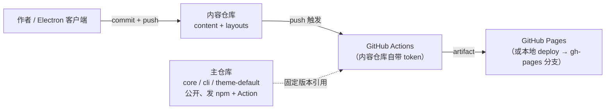

# 轻维基 · 项目设计

> 状态：设计讨论阶段（2026-11-15）
> 本文取代初稿；初稿的三仓库设想与工作流为什么被改掉，见文末「附录」。

## 0. 定位

**一句话**：一个版本化的静态知识库。内容用 markdown + frontmatter 编写，git 管理版本，由独立的编译模块渲染成静态站点，可选用 GitHub Pages 发布。

**对外表述**建议用「版本化的静态知识库」，不要与 MediaWiki 那类工具做类比（原因见 §8）。

**目标**：做成开源产品，让别人能自己搭站。因此以下四条是不可谈判的约束：

1. 站点必须**单仓库可复现**——克隆一个仓库就能完整复现，不需要 submodule、跨仓库拉取或额外凭据。
2. 构建**不引入跨仓库凭据**——内容仓库用自带的 `GITHUB_TOKEN` 部署，工具来自公开仓库。
3. 主题**可升级**——用户覆盖得越少，升级越无痛；不允许出现「拷一份主题然后永远停在旧版」。
4. **产物可移植**——`dist/` 是一组自包含的静态文件，能放到任何地方（含用 `file://` 直接打开），不绑定任何托管平台。

## 1. 已定决策

| # | 决策 | 结论 | 理由 |
|---|---|---|---|
| 1 | 主仓库分发方式 | **npm 包 + GitHub Action**，不靠 fork 使用 | fork 的上游同步成本极高，实际会退化成「永不升级」 |
| 2 | 构建在哪跑 | **内容仓库的 CI** | 零额外凭据；主仓库去拉别人的仓库需要 PAT，安全负担落到长期 |
| 3 | 仓库数量 | **主仓库（monorepo）+ 内容仓库** | 内容与布局必须同仓，才能单仓库复现 |
| 4 | 主题形态 | **可解析的包**（npm / git URL / 本地路径）+ 继承覆盖 | 主题随时可独立成仓库，成本为零，所以现在不拆 |
| 5 | 产物形态 | **一组可移植的静态文件**（`dist/` = html + assets） | 无服务器依赖、无 SPA、无外部 CDN；这是「无供应商锁定」的全部内容（见 §6） |
| 6 | 发布方式 | **发布适配器**：默认 Actions，另有 branch / 本地 fs / 第三方目标 | 计划限制与私有需求各不相同；构建与发布必须解耦（见 §6.3） |
| 7 | 布局语言 | **轻量模板引擎（A 方案）** | 目标用户是「会改 HTML 的人」，主题作者数量比能力上限更重要 |
| 8 | 许可 | **代码/主题宽松，内容逐页标注** | 两者本来就该分开（见 §7） |
| 9 | 客户端 | Electron 客户端**后置**，先做 CLI | 客户端 90% 的工作量在认证与 git 状态，与编译链无关 |

## 2. 仓库形态

### 2.1 主仓库（开源，即产品本身）

```
wiki/
├── packages/
│   ├── core/            # md + frontmatter → HTML + 元数据 + 校验（框架无关，不认识托管平台）
│   ├── schema/          # frontmatter 的 zod schema，带 schemaVersion
│   ├── cli/             # bin: wiki build / dev / check / new / deploy
│   ├── deploy/          # 发布适配器：github-pages / fs / cloudflare / none
│   └── theme-default/   # 默认主题，本身就是一个可发布的包
├── action/              # 薄壳：setup-node → install → build → deploy
├── examples/            # 冒烟构建样例站，CI 必跑
└── docs/                # 文档站，用自己这套系统搭（自己吃狗食）
```

`core` 保持**框架无关**：只负责 markdown → HTML、元数据收集、链接图计算、校验，不认识任何具体渲染框架。渲染交给主题层。

### 2.2 内容仓库（GitHub Template Repository）

用户点「Use this template」创建，结构固定：

```
my-wiki/
├── content/             # *.md + frontmatter（也可换成别的目录名，配置里指定）
├── layouts/             # 可选：覆盖主题的同名模板
├── assets/              # 图片等静态资源
├── wiki.config.ts       # extends: '@scope/theme-default'、siteUrl、schemaVersion
├── package.json         # 固定版本的工具链依赖
├── COMPLIANCE.md        # 内容合规须知（见 §7）
└── .github/workflows/deploy.yml
```

内容仓库依赖固定版本的工具链，本地 `wiki dev` 与 CI 行为一致；升级 = 改一行版本号（配 Renovate/Dependabot 自动开 PR）。

### 2.3 发布链路



全链路不需要任何跨仓库凭据。**这是必须守住的架构红利**，一旦引入跨仓 token，后续的过期、权限收窄、泄露面都会成为长期负担。

## 3. 模板系统

### 3.1 继承与覆盖

主题不是「拷一份当起点」，而是**继承 + 覆盖**。渲染某页时按优先级查找：

```
1. 内容仓库 layouts/<name>       ← 用户覆盖，优先级最高
2. 主题包 layouts/<name>
3. core 内置 fallback            ← 保证任何情况下都能渲染出东西
```

这样主题能升级：上游改了默认 TOC 结构，用户只对自己覆盖过的几个文件负责。反之，如果用户拿的是主题的整份拷贝，就永远停在旧版上——这是同类静态站生成器最常见的用户流失点。

### 3.2 布局语言

采用轻量模板引擎（EJS / Nunjucks / Eta 一类，具体选型待定），要求：

- 「改布局」就是改 HTML 文件，不引入新的组件范式；
- 支持 `include` / `extends` / 变量与简单循环；
- 模板上下文由 core 提供且**有文档化的稳定契约**。

搜索、TOC、翻页、主题切换这类交互，走「构建期生成静态索引 + 少量原生 JS」，不引入前端框架。索引默认输出为 `.js` 而非 `.json`，原因见 §6.2。若将来需要更强的交互，可以按 island 方式局部增强，不影响模板骨架。

### 3.3 主题包契约

一个目录满足以下条件即可作为主题被 `extends` 引用（无论它是 npm 包、git 仓库还是本地路径）：

- `layouts/`：模板文件，文件名即布局名；
- `assets/`：CSS / 字体 / 脚本，支持被 core 收集并输出到产物；
- 可选的 `theme.config` schema，用于校验用户提供的主题参数；
- 可选的钩子（如 `onPageRendered`），用于注入脚本或改写产物。

## 4. 内容模型

frontmatter 由 `@scope/schema` 校验，错误信息必须人能看懂（指出文件、字段、期望值）。

```yaml
---
title: 页面标题
type: doc                 # 决定套用哪个布局
date: 2026-11-15
updated: 2026-11-15
tags: [示例]
draft: false
# —— 合规字段，见 §7 ——
license: CC-BY-SA-4.0
source: https://zh.wikipedia.org/wiki/示例?oldid=12345678
authors: ["原作者A", "译者B"]
modified: true
---
```

约定：

- `schemaVersion` 放在 `wiki.config.ts`（站点级），页面可覆盖；
- 新增字段走**弃用期**而非直接报错，保证内容仓库与工具版本脱钩时不至于一次全红；
- `license` 保持**自由字符串**，不做枚举——除 CC 家族外还有 GFDL、ODbL、专有授权等合法场景，枚举会挡住真实需求。

## 5. 构建能力（core 的职责）

| 能力 | 说明 |
|---|---|
| markdown 渲染 | CommonMark + 常用扩展（表格、脚注、定义列表） |
| 链接图 | 构建期建立全站链接关系，供下面几项使用 |
| **反向链接** | 每页列出「哪些页面链向它」 |
| **红链** | 链接目标不存在时高亮标记，暴露待补内容 |
| **孤页报告** | CI 输出「没有任何页面链向它」的清单 |
| 搜索索引 | 构建期生成静态索引；默认输出为 `.js`（`file://` 下 `fetch` 本地 JSON 会被 CORS 挡） |
| 署名块生成 | 依据 frontmatter 的 `license` / `source` / `authors` 自动渲染，见 §7 |
| 产物路径 | `basePath` / `urlStyle` 决定链接形态，保证产物可搬到任意目录（见 §6.2） |
| 资源与 URL | 图片处理、slug/permalink 覆盖、sitemap、RSS |

反向链接、红链、孤页三项都是链接图的副产品，成本极低，但决定了内容能否「连成网」。建议 v0.1 就带上。

## 6. 产物与发布

### 6.1 硬约束：产物是一组可移植的静态文件

`wiki build` 的产物 `dist/` 是**自包含的纯静态目录**，离开任何服务器都能用：

```
dist/
├── index.html
├── <各页面>.html
├── assets/
│   ├── style.css
│   ├── app.js
│   └── fonts/ img/
├── search-index.js
├── LICENSE.txt
└── meta.json          # 构建时间、工具版本、schemaVersion，便于归档追溯
```

必须满足：

- **无服务器依赖**：任意静态托管、对象存储、`file://` 双击、U 盘、光盘镜像都能用；
- **无 SPA**：每个 URL 对应一个真实存在的 `.html` 文件，不依赖服务端 rewrite；
- **无外部 CDN**：字体 / 脚本 / 样式随产物分发，否则离线、内网、归档场景全部失效；
- **无运行时要求**：产物里不能出现「需要先装点什么才能跑」的东西。

这不是可选项。它是「无供应商锁定」这一卖点的全部内容，也决定了产物能否进 CHM、进离线镜像、进任何第三方归档。

### 6.2 为「随便放哪儿」必须提供的开关

| 开关 | 取值 | 解决的问题 |
|---|---|---|
| `basePath` | 相对（默认）/ 绝对 / 指定前缀 | 产物放子目录（`/repo-name/`）或用 `file://` 打开时链接不断 |
| `urlStyle` | `directory`（`a/b/`）/ `file`（`a/b.html`） | `directory` 适合 Pages；`file` 适合 `file://` 与 CHM（后者不会自动加载 `index.html`） |
| `searchIndex` | `js`（默认）/ `json` | `file://` 下 `fetch()` 本地 JSON 会被 CORS 拒绝，`<script src>` 不受此限 |
| `assetsMode` | `external`（默认）/ `inline` | 需要单文件分发或邮件发送时可内联 |
| `offsite` | `deny`（默认）/ `allow` | 默认禁止外部资源引用，保证离线可用 |

### 6.3 发布适配器

构建与发布解耦：`build` 只产出 `dist/`，没有任何副作用；发布是独立子命令。

```
wiki build
wiki deploy --target github-pages --mode actions    # 默认：upload-pages-artifact + deploy-pages
wiki deploy --target github-pages --mode branch     # 推到 gh-pages 分支，源设为 Deploy from a branch
wiki deploy --target fs --to /mnt/archive/wiki      # 复制到任意目录
wiki deploy --target cloudflare                     # 站点需要访问控制时的出路
wiki deploy --target none                           # 完全交给用户自己的 CI
```

这样 `core` 永远不认识托管平台，Electron 客户端调用的也是同一个适配器。

### 6.4 托管选型：把「仓库私有」和「站点私有」分开

| 仓库 | 站点 | 可行方案 | 成本 |
|---|---|---|---|
| 公开 | 公开 | GitHub Actions + deploy-pages | 0 |
| 私有 | 公开 | 同上（需计划支持），或本地构建 + branch 模式 | Pro ≈ $4/月 |
| 私有 | **私有** | **Cloudflare Pages + Access** / Netlify / 自托管 | 0 起 |

关键事实（依据 GitHub 官方文档）：

- **Pages 站点永远可在公网访问，即使仓库是私有的**。想让站点也私有，GitHub Pages 本身做不到。
- Free 计划（个人与组织）对**私有仓库**不开放 Pages，需要 Pro / Team / Enterprise Cloud。
- Actions 计费已改为金额额度：Free 含约 $12/月（≈2000 分钟 Linux 2-core）；公开仓库的 runner 免费，且官方明确把「For GitHub Pages」列为免费项。静态站构建 1–3 分钟，**成本从来不是决策因素，计划的可用性才是**。

### 6.5 从本地或外部 CI 发布到 Pages 的三个坑

官方允许「用其他 CI 构建 → 把产物推到 `gh-pages` 分支 → GitHub 自动跑一个只做部署的 workflow」。落地时必须注意：

1. **Pages 的 Source 必须是「Deploy from a branch」**。若设为 GitHub Actions，就只能走 artifact 链路，本地产物无法直接喂入。
2. **不能用 `GITHUB_TOKEN` 推送**：官方明确，用 `GITHUB_TOKEN` 推送的提交不会触发 Pages 构建。本地发布要用 PAT（`contents: write`），或用更推荐的 **deploy key**（权限最小，可绑单仓库）。
3. **`gh-pages` 用 orphan 单提交 + force push**，分支里永远只有一个 commit，不会膨胀；产物根目录必须有 `.nojekyll`。

（此前以「gh-pages 会膨胀」为由否掉分支模式是错的，用 orphan 单提交即可解决。）

### 6.6 CHM 一类归档目标

产物塞进 CHM 在格式上没有障碍，但 CHM 使用旧 Trident 引擎（接近 IE7/8 的 CSS 水平、无 ES6、无 SVG）。默认主题若使用现代布局与 CSS 变量，在 CHM 里会散架。

因此：

- **不承诺 CHM 支持**，但产物设计不能堵死这条路；
- 未来可提供 `--profile legacy`：输出 ES5 脚本与老式布局的降级版本；
- 文档里要明确「能做，但不是开箱即用」，避免用户拿默认产物直接打包后得到一个白板。

## 7. 许可与署名

### 7.1 责任边界（重要）

工具只保证**机制**，不替用户做法务判断：

**工具负责**
- 允许页面级标注许可证与来源；
- 标了 `license` 就**自动生成**符合规范的署名块，不需要用户手写；
- 检出明显冲突（如站点级是宽松协议、某页是 `CC-BY-SA-4.0`）时给出警告。

**工具不负责**
- 判断某段内容是否合规、是否构成侵权；
- 判定某许可证组合是否合法。

这个边界靠 `COMPLIANCE.md`（模板仓库预置）向用户交代清楚，因为开源产品的用户大概率不懂 CC 条款。

### 7.2 分层许可

| 层 | 协议 | 说明 |
|---|---|---|
| core / cli / action | MIT 或 Apache-2.0 | 宽松，便于集成，与内容无关 |
| theme-default | 同上 | 模板与样式按代码算 |
| 项目自带的示例内容 | 原创 → CC BY 4.0 或 CC0；改编自维基 → 必须 CC BY-SA 4.0 | 看来源 |
| 用户自己的内容 | 由用户决定 | 工具不预设 |

**项目整体不需要是 CC 协议**，需要的是「页面级可标注 + 产物里带署名」。

### 7.3 三个必须写进 COMPLIANCE.md 的坑

1. **ND（NoDerivatives）内容不能翻译。** 翻译属于改编，`CC BY-NC-ND` 直接禁止。
2. **ShareAlike 感染的是「改编」，不是「汇集」。** 原样收录一篇 BY-SA 文章，整站不必跟着变；但一旦翻译、改写、增删，**那一页**就是 BY-SA 改编作品，必须仍以 BY-SA 发布。本项目的典型用法正是翻译加工，所以按「会感染」设计。
3. **协议版本只可升级、不可降级。** 从维基百科（BY-SA 4.0）取内容，产出必须署 BY-SA 4.0，不能放宽成 CC BY。

### 7.4 署名必须跟着内容走

署名块由渲染器生成，写入**产出的 HTML** 中，而不是只写在仓库 README 里——因为别人可能只分享你站点上的某一个页面。署名块需包含：创作者、版权声明、许可名称与链接、是否经过修改的说明、原作品链接。

同时输出：`/licenses` 页面、每页 `<link rel="license">`、RSS 与 sitemap 中的许可信息。

站点内混合「原创 CC BY」与「译自维基的 BY-SA」是合法的，前提是每页标清、产物带署名。因此**许可证是页面级属性，不是站点级属性**，这一点必须在 schema 设计时就固定下来。

## 8. 我们不是 wiki

wiki 的定义性特征不是「有页面、能互链」，而是**纠错成本极低**：看到错字 30 秒内改完即生效。本项目的流程是「打开客户端 → 认证 → 修改 → 提交 → 等 PR 合并」，摩擦高两个数量级。它更接近「社区可投稿的文档站」（MDN、Vue 文档这一族）。

因此：

- 名称保留「轻维基」没问题，「轻」字已做区分；
- 但对外描述要用「版本化的静态知识库」，避免用户带着「浏览器里点编辑」的预期进来；
- 补一个几乎零成本的入口：每页「编辑此页」直链到 `github.com/<owner>/<repo>/edit/main/content/<file>.md`。

## 9. 版本与兼容

- 用 changesets 管理版本；
- `core` 的 major 版本与 `schemaVersion` 挂钩，语义变更必须走弃用期；
- 模板仓库预置 Renovate/Dependabot 配置，升级表现为一个 bot PR；
- **`examples/` 每次 CI 必须构建成功**——防止改了 core 忘了同步 `theme-default`，这是开源项目最典型的「发版即炸」。

## 10. 路线图

| 阶段 | 内容 |
|---|---|
| v0.1 | `core` + `cli`（`build` / `dev` / `check`）+ `theme-default` + Action；内容仓库模板；反向链接、红链、孤页报告；署名块生成；产物可移植性（`basePath` / `urlStyle` / 搜索索引输出 `.js`）；`deploy --target fs` 与 `--mode branch` |
| v0.2 | Electron 客户端：连接仓库、编辑与预览、commit + push（认证走 OAuth Device Flow；冲突不处理，直接给「去网页解决」的链接） |
| v0.3+ | 搜索、i18n、主题生态、PR 流程支持；`--profile legacy`（ES5 + 老式布局，面向 CHM 与老旧环境） |

## 11. 待定项

- 包名与 npm scope；
- 轻量模板引擎的具体选型（EJS / Nunjucks / Eta）；
- 包管理器：`pnpm workspace` 或 `yarn 4 workspace`（后者需注意 yarn 4 对某些 postinstall 的处理差异）；
- `wiki dev` 的粒度：手动重建即可，还是需要内容热更新（后者要求 core 支持增量处理，会影响接口设计）；
- 搜索方案（Pagefind 与「构建期生成 + 纯 JS 过滤」之间的取舍，后者对 `file://` 更友好）；
- 图片等二进制资源的治理策略（单文件上限、压缩建议、是否后续接外部存储）；
- `deploy` 适配器首批覆盖的目标（至少 github-pages 与 fs，cloudflare 是否进入 v0.1）；
- 是否提供 `--profile legacy`，以及它对主题维护成本的影响。

---

## 附录：初稿与修订理由

初稿设想（2026-11-15 之前）：

1. 用户侧用 markdown + frontmatter 定义模板、编写内容；
2. git 管理版本，给无 git 经验的用户提供 Electron 界面；
3. 独立模块负责编译，可选发布到 GitHub Pages；
4. **三个仓库**：主仓库（业务逻辑 + 发布 Pages，允许用户 fork 走）、内容仓库（由模板创建）、可能的 HTML 模板仓库；
5. 工作流：主仓库触发 → 拉取另外两个仓库 → 编译 → 提交到主仓库的 GitHub Pages。

修订内容与原因：

| 初稿 | 改为 | 原因 |
|---|---|---|
| 用户 fork 主仓库使用 | 依赖固定版本的 npm 包 / Action | fork 的上游同步成本极高，实际不会有人持续跟进 |
| 主仓库拉取内容与主题仓库 | 内容仓库自己的 CI 拉取工具 | 跨仓拉取需要 PAT，长期安全负担；反向后零凭据 |
| 三个仓库 | 两个（主题先作为包留在主仓库） | 主题只要能被解析成包就可以随时拆出，提前拆只增加同步成本 |
| 提交产物到 gh-pages（唯一方式） | 默认 Actions artifact + deploy-pages，branch 模式作为可选 | 原以为分支模式必然膨胀，实际用 orphan 单提交即可解决；两种都保留是因为计划限制与私有需求并存（见 §6.5） |
| 「定义模板」含义不清 | 明确为「继承 + 覆盖」的布局系统 | 直接改主题的整份拷贝会失去升级路径 |
| 未涉及许可 | 页面级许可 + 自动署名块 | 翻译/加工他人 CC 内容属于改编，ShareAlike 会约束这部分内容的发布方式 |
| 初稿称「Wiki」 | 对外称「版本化的静态知识库」 | 缺少低摩擦就地编辑，与用户对 wiki 的预期不符 |
| 未考虑产物的去向 | 产物是一组可移植静态文件，提供 `basePath` / `urlStyle` / 索引输出 `.js` | 用户可能把产物放进子目录、用 `file://` 打开、打包成 CHM 或离线镜像 |
| 发布写死在 Action 里 | 发布适配器，`core` 与托管平台解耦 | Free 计划不给私有仓库开 Pages；也有用户要求站点本身私有 |


