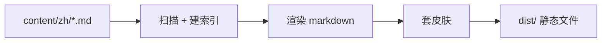

构建期能算完的事，工具都替你算了：代码高亮、搜索索引、页内目录。但有一类库必须跑在浏览器里，比如画图要测量文本尺寸。

这一页用 mermaid 走一遍完整链路。本站这张图就是它画的：



下面这些配置只在这一页生效，其它页面没有这两个脚本。

## 库放哪：两种选择

| 方式 | 写法 | 好处 | 坏处 |
|---|---|---|---|
| CDN | `https://cdn.jsdelivr.net/npm/mermaid@12.3.0/dist/mermaid.min.js` | 仓库里不占体积，升级只改版本号 | 依赖网络；墙内不稳定；对方挂了页面就少一块；产物变成依赖外部的静态文件 |
| 下载到本地 | `vendor/mermaid.min.js` | 离线可用、版本锁死、国内访问没问题、产物可以整个拷走 | 仓库多几 MB；升级要手动换文件；`--inline` 时会被塞进每个页面 |

本站选的是本地。文档站的产物要能整个打包带走、扔进离线环境，一个 CDN 就能让它失效。

> mermaid 12 的 `dist/` 里有两套：`mermaid.min.js` 是单文件 UMD，5.5 MB；`mermaid.esm.min.mjs` 只是入口，要靠几十个 `chunks/*.mjs` 拼起来。要放本地就下前者，一个文件，升级时换它就行。

## 挂到页面上

`scripts` 字段按声明顺序注入，`mermaid.min.js` 必须在初始化脚本之前：

```yaml
scripts:
  - vendor/mermaid.min.js
  - mermaid-init.js
```

两个文件都放在 `assets/` 下，`vendor/` 是习惯用法，用来跟自己的脚本分开。

字段本身能写几种形态，见 [JavaScript](/docs/basics/javascript)。

**站外地址也能写。** 想用 CDN 就直接填完整地址：

```yaml
scripts:
  - src: https://cdn.jsdelivr.net/npm/mermaid@12.3.0/dist/mermaid.min.js
```

`styles` 同理。站外地址原样进产物，不查本地文件、不加站点前缀，`--inline` 也不会去内联它（那本来就不归我们管）。

## 初始化脚本

`assets/mermaid-init.js`：

```js
(function () {
  var mermaid = window.mermaid;
  if (!mermaid) return;

  var blocks = document.querySelectorAll('pre > code.language-mermaid');
  if (!blocks.length) return;

  var nodes = [];
  for (var i = 0; i < blocks.length; i += 1) {
    var code = blocks[i];
    var host = document.createElement('div');
    host.className = 'mermaid';
    host.textContent = code.textContent || '';
    if (code.parentElement) code.parentElement.replaceWith(host);
    nodes.push(host);
  }

  var dark = window.matchMedia && window.matchMedia('(prefers-color-scheme: dark)').matches;

  mermaid.initialize({
    startOnLoad: false,
    theme: dark ? 'dark' : 'default',
    securityLevel: 'strict',
  });

  Promise.resolve(mermaid.run({ nodes: nodes })).catch(function (error) {
    console.error('[mermaid]', error);
  });
})();
```

三件事值得注意：

- **代码块是 `<pre><code class="language-mermaid">`**，mermaid 认的是元素本身，所以先把内容搬进一个 `div.mermaid`，再换掉原来的 `pre`
- **`theme` 跟着 `prefers-color-scheme` 走**，不然深色页面上会蹦出一张白底的图
- **`securityLevel: 'strict'`** 会禁掉图里的 HTML 标签与脚本，站内文档建议开着

## 脚本什么时候执行

`scripts` 注入的脚本自动带 `defer`，在 DOM 解析完、`DOMContentLoaded` 之前执行。所以初始化脚本里可以直接查元素，不需要等事件。

`module: true` 的脚本不带 `defer`，但 module 本来就是延迟执行的，时机一样。

## 几个会让人卡住的点

**CDN 挂了看不出来。** 页面照常渲染，只是那块图保持代码块的样子。打开控制台才会看到加载失败。

**`wiki check` 不检查站外地址。** 它只确认本地 `assets/` 下的文件存在，CDN 上的东西看不见，写错域名也不会报。

**`--inline` 会把本地库塞进页面。** 5.5 MB 的 mermaid 变成内联脚本后，那一页的 HTML 会大好几倍。站外地址不受影响，原样保留。

**升级要手动。** 本地方式没有版本解析，换文件就是升级，记得顺手改注释或文件名里的版本号。

## 只在某一页用

上面就是做法：只在那页的 frontmatter 写 `scripts`。不想让全站都加载 5.5 MB，就别放进皮肤。

反过来，想让全站都能画图，就把两个 `<script>` 写进皮肤，或者在自己的 `layouts/nav.eta` 旁边放一个共用片段。皮肤的写法见 [皮肤](/docs/basics/skins)。
